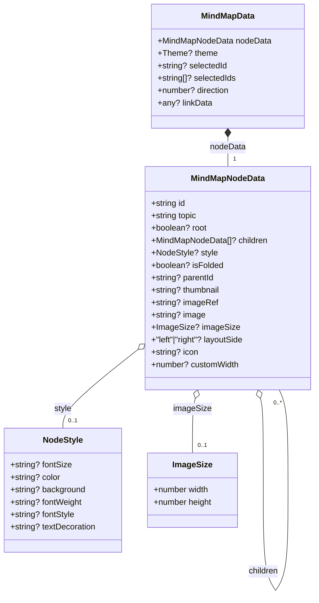
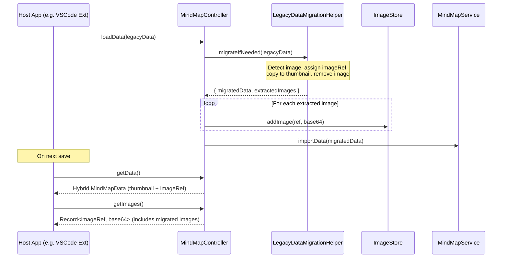

[日本語](./JSON_DATA_SPEC_ja.md)

# Kakidash JSON Data Specification

## 1. Overview

This document defines the official JSON data format (`MindMapData`) serialized by `kakidash.getData()` and deserialized by `kakidash.loadData()` in Kakidash (target version: `v0.4.1`).

| Item | Specification |
| --- | --- |
| Format | JSON (RFC 8259) |
| Character Encoding | UTF-8 |
| Common File Extensions | `.kaki` (e.g., VSCode extension integration) or `.json` |
| JSON Schema | [kakidash.schema.json](./schema/kakidash.schema.json) (JSON Schema Draft 2020-12) |
| TypeScript Types | `MindMapData`, `MindMapNodeData`, `NodeStyle`, `Theme` ([MindMapData.ts](../src/features/core/domain/MindMapData.ts) / [Node.ts](../src/features/core/domain/Node.ts)) |
| Public APIs | `kakidash.getData()`, `kakidash.loadData(data)`, `kakidash.getImages()`, `kakidash.gcImages()` |

---

## 2. Data Structure Overview

A Kakidash JSON document consists of a top-level `MindMapData` object containing a recursive tree of `MindMapNodeData` objects under `nodeData`.



---

## 3. Top-Level Object Specification (`MindMapData`)

| Field | Type | Required | Default | `getData()` Output | `loadData()` Behavior | Description |
| --- | --- | --- | --- | --- | --- | --- |
| `nodeData` | `MindMapNodeData` | **Required** | — | Always emits the root node | Recursively constructs the entire node tree | Root node of the mind map. |
| `theme` | `Theme` | Optional | `'default'` | Emits current theme | Applies theme if provided | Visual theme applied to the mind map. See [Section 6](#6-theme-specification-theme). |
| `selectedId` | `string` | Optional | — | Emits primary selected node ID (omitted when none selected) | Fallback selection when `selectedIds` is omitted or empty | Primary selected node ID. Added by `MindMapController.getData()` (not emitted by `MindMapService.exportData()` directly). |
| `selectedIds` | `string[]` | Optional | `[]` | Emits array of selected node IDs (`[]` when none selected) | Restores multi-selection when non-empty (takes precedence over `selectedId`) | Array of currently selected node IDs. Added by `MindMapController.getData()`. |
| `direction` | `number` | Optional (Reserved) | — | **Not emitted** | **Ignored** | Reserved numeric field (only set to `1` by `XMindImporter`). The active `LayoutMode` is not persisted in JSON. |
| `linkData` | `any` | Optional (Reserved) | — | **Not emitted** | **Ignored** | Reserved field for future cross-node links or relationships. |

---

## 4. Node Object Specification (`MindMapNodeData`)

| Field | Type | Required | Default | Constraints & Behavior | Description |
| --- | --- | --- | --- | --- | --- |
| `id` | `string` | **Required** | Initial root `'root'` | Non-empty (`minLength: 1`), unique across the entire tree | Unique node identifier. Generated via `crypto.randomUUID()` (fallback: `Date.now().toString(36) + Math.random().toString(36).substr(2)`). |
| `topic` | `string` | **Required** | Initial root `'Root Topic'` / New node `'New topic'` / Image `''` | Supports newlines (`\n`). URLs matching `https?://[^\s]+` are auto-linked on render | Node text content. Empty string `""` for image-only nodes. |
| `root` | `boolean` | Optional | `true` for root only | `exportData()` emits `true` only on the root and omits it on children. `importData()` always sets `isRoot = true` for top-level `nodeData` and `false` for descendants | Root node marker. Setting `root: true` explicitly on top-level `nodeData` is recommended for clarity. |
| `children` | `MindMapNodeData[]` | Optional | `[]` | Omitted by `exportData()` when empty. Array order determines display order | Ordered list of child nodes (recursive). |
| `style` | `NodeStyle` | Optional | Root `{ fontSize: '24px' }` / Child `{ fontSize: '16px' }` | Omitted by `exportData()` when empty. On `importData()`, replaces the default style object | Per-node inline styling. See [Section 5](#5-style-specification-style). |
| `isFolded` | `boolean` | Optional | `false` | Always emitted as boolean by `exportData()`. Leaf nodes cannot be folded via UI/service | Whether child nodes are collapsed (`true` hides descendants). |
| `layoutSide` | `'left' \| 'right'` | Optional | `undefined` | Effective on direct children of root when `LayoutMode === 'Both'` | Preferred side relative to root. If omitted, determined by child index parity (`index % 2 === 0 ? 'right' : 'left'`). |
| `icon` | `string` | Optional | `undefined` | Built-in SVG icon ID (30 built-ins) or arbitrary fallback text/emoji | Leading icon displayed on text nodes. See [Section 7](#7-icon-specification-icon). |
| `customWidth` | `number` | Optional | `undefined` | Positive number (`> 0`). UI enforces a minimum of `50` px | Per-node maximum width in pixels, overriding the global `maxNodeWidth` option for text wrapping. |
| `thumbnail` | `string` | Optional | `undefined` | Base64 Data URL (e.g., `data:image/webp;base64,...`) | Lightweight embedded thumbnail image used in hybrid image storage. |
| `imageRef` | `string` | Optional | `undefined` | Non-empty (`minLength: 1`). Paste: `img_<9alnum>.png`; Migration: `<uuid>.<ext>` | Reference ID or filename of the original high-resolution image stored externally (`ImageStore` / sidecar folder). |
| `image` | `string` | Optional (**Deprecated**) | `undefined` | `@deprecated` since v0.4.0. Full Base64 Data URL | Legacy embedded full-resolution image. Automatically migrated to `thumbnail` + `imageRef` on `loadData()`. |
| `imageSize` | `{ width: number; height: number }` | Optional | `undefined` | `width > 0`, `height > 0` (px) | Image dimensions in pixels. Clamped to max width `150px` preserving aspect ratio when rendered (`150×150px` max if omitted). |
| `parentId` | `string` | Optional (Reserved) | — | **Not emitted** on `exportData()`; **ignored** on `importData()` | Reserved parent ID field. Parent-child links are reconstructed from nested `children`. |

---

## 5. Style Specification (`style`)

`MindMapNodeData.style` uses the `NodeStyle` interface with CSS string values.

| Property | Type | Default (on `Node` construction) | UI Presets / Common Values | Description |
| --- | --- | --- | --- | --- |
| `fontSize` | `string` | Root `'24px'` / Child `'16px'` | `'12px'`, `'14px'`, `'16px'`, `'18px'`, `'24px'`, `'32px'`, `'48px'` | Font size (CSS `font-size`) |
| `color` | `string` | Theme default | 7 palette colors below or any CSS color | Text color (CSS `color`) |
| `background` | `string` | Theme default | Any CSS color (e.g., `'#FFF3CD'`, `'transparent'`) | Background color (CSS `background-color`). Configurable via API / JSON (not exposed in StyleEditor UI) |
| `fontWeight` | `string` | Root `'bold'` via theme / Child unset | `'bold'`, `'normal'` | Font weight (CSS `font-weight`) |
| `fontStyle` | `string` | Unset | `'italic'`, `'normal'` | Font style (CSS `font-style`) |
| `textDecoration` | `string` | Unset | `'line-through'`, `'none'` | Text decoration / strikethrough (CSS `text-decoration`) |

### Built-in Color Palette (`StyleEditor.PALETTE`)

| Shortcut Key | Name | Hex Value |
| --- | --- | --- |
| `1` | Black | `#000000` |
| `2` | Red | `#E74C3C` |
| `3` | Orange | `#E67E22` |
| `4` | Yellow | `#F1C40F` |
| `5` | Green | `#2ECC71` |
| `6` | Blue | `#3498DB` |
| `7` | Purple | `#9B59B6` |

> [!NOTE]
> When `data.style` is provided during `importData()`, it replaces the constructor's default `style` object (`{ ...data.style }`). Include `fontSize` explicitly if you want to preserve default sizing alongside other custom style properties.

---

## 6. Theme Specification (`theme`)

| Theme Value | Description | Toolbar (`LayoutSwitcher`) Button |
| --- | --- | --- |
| `'default'` | Standard bordered nodes (default) | Yes |
| `'simple'` | Minimal borderless child nodes | Yes |
| `'colorful'` | Color-coded branches using a 7-color rainbow palette | Yes |
| `'dark'` | Dark canvas with light foreground text | No (API / JSON only) |
| `'custom'` | Uses custom styles supplied via `updateGlobalStyles()` or `options.customStyles` | Yes |

> [!IMPORTANT]
> Custom style definitions (`MindMapStyles`) are not persisted inside `MindMapData` JSON. Host applications restoring a `'custom'` theme document should also provide `options.customStyles` or call `updateGlobalStyles()`.

---

## 7. Icon Specification (`icon`)

`icon` accepts any of the 30 built-in SVG icon IDs or an arbitrary fallback string (such as an emoji).

### 7.1 Flat Icons (10)

| `icon` ID | Label / Meaning | Primary Color |
| --- | --- | --- |
| `blue_circle` | Good | `#3498DB` |
| `red_circle` | Bad | `#E74C3C` |
| `question` | Question | `#95A5A6` |
| `important` | Important (Star) | `#F1C40F` |
| `check` | Check | `#2ECC71` |
| `cross` | Cross | `#E74C3C` |
| `flag` | Flag | `#E67E22` |
| `idea` | Idea | `#F39C12` |
| `warning` | Warning | `#E67E22` |
| `schedule` | Schedule | `#3498DB` |

### 7.2 Numeric Icons (20)

- **Blue numeric icons (10, `#3498DB`)**: `num_0_blue` through `num_9_blue`
- **Red numeric icons (10, `#E74C3C`)**: `num_0_red` through `num_9_red`

### 7.3 Fallback & Reserved Keyword

- Any string not matching the 30 built-in IDs is rendered as plain text inside a `<span>` (allowing emoji or custom markers).
- `'delete'` is a reserved keyword for removing an icon via `updateNode(id, { icon: 'delete' })` and should not be persisted in JSON.

---

## 8. Image Data Specification (Hybrid Storage & Legacy Migration)

Since v0.4.0, Kakidash uses **hybrid image storage** to keep JSON documents compact and Git-friendly.

### 8.1 Hybrid Storage Fields

- **`thumbnail`**: Lightweight Base64 Data URL embedded directly in JSON. On paste, `ImageProcessingService` generates a thumbnail with defaults `maxWidth: 200`, `quality: 0.7`, MIME type `image/webp` (falling back to `image/jpeg`).
- **`imageRef`**: External reference key or filename identifying the original high-resolution image in `ImageStore` and the host's sidecar directory.
  - Paste format: `img_<9alnum>.png`
  - Legacy migration format: `<uuid>.<ext>` (`png`, `jpeg`, `jpg`, `gif`, or `webp`; defaults to `png`)
- **`imageSize`**: `{ width, height }` in pixels. Clamped to `150px` max width while maintaining aspect ratio on canvas render.
- A node is treated as an image node when `thumbnail` or `image` is present (`topic` is `""`).

### 8.2 Automatic Legacy Migration (`@deprecated image`)

When `loadData()` receives legacy v0.3.x data (or `XMindImporter` output) containing `image`, `LegacyDataMigrationHelper.migrateIfNeeded()` automatically migrates it to hybrid format and registers the extracted originals in `ImageStore`.



> [!WARNING]
> **Security Note for Host Applications (Path Traversal Prevention)**:
> Never join untrusted `imageRef` values directly into filesystem paths when reading or writing sidecar files. Always sanitize filenames (e.g., `path.basename(imageRef)`) and verify that the resolved path stays strictly inside the designated sidecar directory to prevent `../` path traversal attacks.

---

## 9. Selection, Layout, and Non-Persisted State

### 9.1 Selection Restoration Precedence

On `loadData()`:

1. If `selectedIds` is present and non-empty, all listed nodes are selected and the first node is scrolled into view.
2. Otherwise, if `selectedId` is present, that node is selected and scrolled into view.
3. Otherwise, selection is cleared and the root node is scrolled into view.

### 9.2 State Not Persisted in JSON

The following runtime states are intentionally excluded from `MindMapData` JSON:

| State | Related API / Option | Notes |
| --- | --- | --- |
| Layout mode (`'Right' \| 'Left' \| 'Both'`) | `setLayoutMode()` / `updateLayout()` | Defaults to `'Right'` on init |
| Custom theme styles (`MindMapStyles`) | `updateGlobalStyles()` / `options.customStyles` | Only `theme: 'custom'` is saved in JSON |
| Global max node width (`maxNodeWidth`) | `setMaxNodeWidth()` / `options.maxNodeWidth` | Only per-node `customWidth` is saved in JSON |
| Viewport pan & zoom | `panBoard()` / `zoomBoard()` / `resetZoom()` | Runtime UI state |
| Undo / Redo history | `undo()` / `redo()` | Managed in memory by `HistoryService` (max 10 states) |
| Read-only mode | `setReadOnly()` | Runtime UI state |
| Original high-resolution image binaries | `getImages()` / `gcImages()` | Persisted separately by host app |

---

## 10. Validation, Compatibility, and Known Constraints

- **No Schema Version Field**: `MindMapData` currently does not include a `version` property. Future additions should remain optional for backward compatibility.
- **No Built-in Runtime Validator**: `loadData()` does not perform JSON Schema validation; runtime exceptions are caught and logged via `console.error`. Use [kakidash.schema.json](./schema/kakidash.schema.json) to validate externally produced JSON files.
- **Reserved / Unused Fields**: `direction`, `linkData`, and `parentId` are accepted by the schema for compatibility, but producers should omit them.

---

## 11. JSON Examples

### 11.1 Minimal Document

```json
{
  "nodeData": {
    "id": "root",
    "topic": "Project Plan"
  }
}
```

### 11.2 Full-Featured Document

```json
{
  "nodeData": {
    "id": "root",
    "topic": "Kakidash Roadmap",
    "root": true,
    "style": {
      "fontSize": "24px",
      "fontWeight": "bold"
    },
    "isFolded": false,
    "children": [
      {
        "id": "550e8400-e29b-41d4-a716-446655440001",
        "topic": "Documentation\nhttps://github.com/hiroooo000/kakidash",
        "icon": "check",
        "layoutSide": "right",
        "customWidth": 260,
        "style": {
          "fontSize": "16px",
          "color": "#2ECC71",
          "fontWeight": "bold"
        },
        "isFolded": false,
        "children": [
          {
            "id": "550e8400-e29b-41d4-a716-446655440002",
            "topic": "Deprecated task",
            "icon": "num_1_blue",
            "style": {
              "fontSize": "14px",
              "fontStyle": "italic",
              "textDecoration": "line-through",
              "color": "#000000"
            },
            "isFolded": false
          }
        ]
      },
      {
        "id": "550e8400-e29b-41d4-a716-446655440003",
        "topic": "Next Release Ideas",
        "icon": "idea",
        "layoutSide": "left",
        "isFolded": true,
        "children": [
          {
            "id": "550e8400-e29b-41d4-a716-446655440004",
            "topic": "Proposal A",
            "isFolded": false
          }
        ]
      }
    ]
  },
  "theme": "colorful",
  "selectedId": "550e8400-e29b-41d4-a716-446655440001",
  "selectedIds": [
    "550e8400-e29b-41d4-a716-446655440001"
  ]
}
```

### 11.3 Hybrid Image Node Document

```json
{
  "nodeData": {
    "id": "root",
    "topic": "Design Review",
    "root": true,
    "isFolded": false,
    "children": [
      {
        "id": "550e8400-e29b-41d4-a716-446655440010",
        "topic": "",
        "thumbnail": "data:image/webp;base64,UklGRh4AAABXRUJQVlA4...",
        "imageRef": "img_k9x2m7p1q.png",
        "imageSize": {
          "width": 200,
          "height": 120
        },
        "isFolded": false
      }
    ]
  },
  "theme": "default",
  "selectedIds": []
}
```

Corresponding `kakidash.getImages()` payload (saved to sidecar storage by the host app):

```json
{
  "img_k9x2m7p1q.png": "data:image/png;base64,iVBORw0KGgoAAAANSUhEUgAA..."
}
```

### 11.4 Legacy Image Format Migration (`@deprecated image`)

Before migration (v0.3.x format):

```json
{
  "nodeData": {
    "id": "root",
    "topic": "Legacy Document",
    "root": true,
    "children": [
      {
        "id": "legacy-img-1",
        "topic": "",
        "image": "data:image/png;base64,iVBORw0KGgoAAAANSUhEUgAA..."
      }
    ]
  }
}
```

After `loadData()` followed by `getData()`:

```json
{
  "nodeData": {
    "id": "root",
    "topic": "Legacy Document",
    "root": true,
    "style": {
      "fontSize": "24px"
    },
    "isFolded": false,
    "children": [
      {
        "id": "legacy-img-1",
        "topic": "",
        "style": {
          "fontSize": "16px"
        },
        "thumbnail": "data:image/png;base64,iVBORw0KGgoAAAANSUhEUgAA...",
        "imageRef": "9b1deb4d-3b7d-4bad-9bdd-2b0d7b3dcb6d.png",
        "isFolded": false
      }
    ]
  },
  "theme": "default",
  "selectedIds": []
}
```
