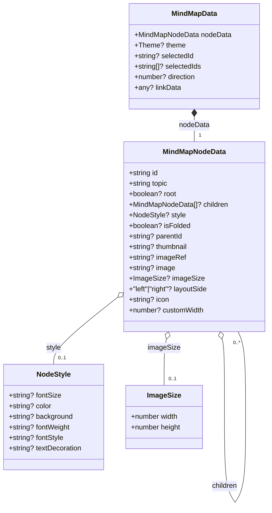
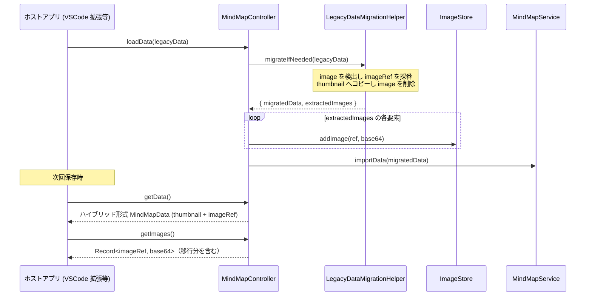

[English](./JSON_DATA_SPEC.md)

# Kakidash JSON データ仕様書

## 1. 概要

本仕様書は、Kakidash（対象バージョン: `v0.4.1` 系）がマインドマップデータのシリアライズ（`getData()`）およびデシリアライズ（`loadData()`）で入出力する JSON フォーマット（`MindMapData`）の正式な仕様を定義します。

| 項目 | 仕様 |
| --- | --- |
| フォーマット | JSON（RFC 8259 準拠） |
| 文字コード | UTF-8 |
| 推奨ファイル拡張子 | `.kaki`（VSCode 拡張機能等での利用例）または `.json` |
| スキーマ定義 | [kakidash.schema.json](./schema/kakidash.schema.json)（JSON Schema Draft 2020-12） |
| 関連 TypeScript 型 | `MindMapData`, `MindMapNodeData`, `NodeStyle`, `Theme`（[MindMapData.ts](../src/features/core/domain/MindMapData.ts) / [Node.ts](../src/features/core/domain/Node.ts)） |
| 関連公開 API | `kakidash.getData()`, `kakidash.loadData(data)`, `kakidash.getImages()`, `kakidash.gcImages()` |

---

## 2. データ構造の全体像

Kakidash の JSON データは、ルートオブジェクト `MindMapData` の配下に再帰的なツリー構造 `MindMapNodeData` を保持します。



---

## 3. トップレベルオブジェクト仕様 (`MindMapData`)

| フィールド | 型 | 必須/任意 | デフォルト値 | `getData()` 出力 | `loadData()` 読込挙動 | 説明 |
| --- | --- | --- | --- | --- | --- | --- |
| `nodeData` | `MindMapNodeData` | **必須** | — | 常にルートノードを出力 | ツリー全体を再帰的に構築 | マインドマップのルートノード。 |
| `theme` | `Theme` | 任意 | `'default'` | 現在のテーマを出力 | 指定されている場合のみテーマを適用 | マインドマップ全体に適用されるテーマ識別子。詳細は「[6. テーマ仕様](#6-テーマ仕様-theme)」を参照。 |
| `selectedId` | `string` | 任意 | — | 単一選択中（または主選択）のノード ID を出力（未選択時は省略） | `selectedIds` が未指定または空の場合のフォールバック選択先 | 主選択ノード ID。`MindMapService.exportData()` 単体では出力されず、`MindMapController.getData()` が付与します。 |
| `selectedIds` | `string[]` | 任意 | `[]` | 選択中ノード ID の配列を出力（未選択時は `[]`） | 要素数 1 以上なら `selectedId` より優先して複数選択を復元 | 複数選択されているノード ID の配列。`MindMapController.getData()` が付与します。 |
| `direction` | `number` | 任意（予約） | — | **出力されない** | **無視される** | 予約フィールド。現状 `XMindImporter` のみ `1` を出力します。現在のレイアウト方向（`LayoutMode`）は JSON に保存されません。 |
| `linkData` | `any` | 任意（予約） | — | **出力されない** | **無視される** | 将来のノード間リンク拡張用の予約フィールド。 |

---

## 4. ノードオブジェクト仕様 (`MindMapNodeData`)

| フィールド | 型 | 必須/任意 | デフォルト値 | 制約・挙動 | 説明 |
| --- | --- | --- | --- | --- | --- |
| `id` | `string` | **必須** | 初期ルート `'root'` | 空文字不可（`minLength: 1`）。ツリー全体で一意であること | ノードの一意識別子。新規作成時は `crypto.randomUUID()`（非対応環境では `Date.now().toString(36) + Math.random().toString(36).substr(2)`）。 |
| `topic` | `string` | **必須** | 初期ルート `'Root Topic'` / 新規 `'New topic'` / 画像 `''` | 改行（`\n`）可。`https?://[^\s]+` は描画時に自動リンク化 | ノードの表示テキスト。画像ノードでは空文字列 `""`。 |
| `root` | `boolean` | 任意 | ルートのみ `true` | `exportData()` はルートのみ `true`、子ノードでは省略。`importData()` ではトップレベルノードを強制的に `isRoot = true`、子孫ノードを `isRoot = false` として復元 | ルートノード判定フラグ。外部ツールで生成する際もルートノードには `true` を明示することを推奨します。 |
| `children` | `MindMapNodeData[]` | 任意 | `[]` | `exportData()` は子が 0 件のとき省略。配列順が表示順 | 子ノードの配列（再帰構造）。 |
| `style` | `NodeStyle` | 任意 | ルート `{ fontSize: '24px' }` / 子 `{ fontSize: '16px' }` | `exportData()` は空オブジェクトのとき省略。`importData()` では指定されたオブジェクトで既定値を置換 | ノード個別のインラインスタイル。詳細は「[5. スタイル仕様](#5-スタイル仕様-style)」を参照。 |
| `isFolded` | `boolean` | 任意 | `false` | `exportData()` は常に `true` または `false` を出力。UI/Service 上では子を持たない葉ノードを折り畳めない | 子ノードの折り畳み状態。`true` のとき配下ノードは非表示。 |
| `layoutSide` | `'left' \| 'right'` | 任意 | `undefined` | `LayoutMode === 'Both'` のときのルート直下ノードに有効 | ルートから見て左右どちらに配置するか。未指定時はルート直下の配列インデックス偶奇で決定（偶数: `'right'`、奇数: `'left'`）。 |
| `icon` | `string` | 任意 | `undefined` | 組み込み SVG アイコン ID（全 30 種）または任意の文字列（絵文字等） | ノード先頭に表示するアイコン。詳細は「[7. アイコン仕様](#7-アイコン仕様-icon)」を参照。 |
| `customWidth` | `number` | 任意 | `undefined` | 正の数値（`> 0`）。UI 操作時の最小幅は `50` px | ノード個別の最大幅（px）。グローバルオプション `maxNodeWidth` より優先され、テキスト折り返し幅を制御します。 |
| `thumbnail` | `string` | 任意 | `undefined` | Base64 Data URL（例: `data:image/webp;base64,...`） | ハイブリッド画像保存方式における軽量サムネイル画像。 |
| `imageRef` | `string` | 任意 | `undefined` | 空文字不可（`minLength: 1`）。ペースト時 `img_<9文字英数>.png`、旧データ移行時 `<uuid>.<ext>` | 外部ストレージ（`ImageStore` / サイドカーフォルダ）上のオリジナル高解像度画像への参照 ID / ファイル名。 |
| `image` | `string` | 任意（**非推奨**） | `undefined` | `@deprecated`（v0.4.0〜）。Base64 Data URL | 旧形式の埋め込み画像データ。`loadData()` 時に `thumbnail` + `imageRef` へ自動移行され削除されます。 |
| `imageSize` | `{ width: number; height: number }` | 任意 | `undefined` | `width > 0`, `height > 0`（px） | 画像のサイズ（幅・高さ）。描画時は幅 `150px` を超える場合アスペクト比を維持して縮小されます。 |
| `parentId` | `string` | 任意（予約） | — | `exportData()` では**出力されない**。`importData()` では**無視される** | 親ノード ID。親子関係は `children` のネスト構造から自動的に再構築されます。 |

---

## 5. スタイル仕様 (`style`)

`MindMapNodeData.style` は `NodeStyle` インターフェースに従い、CSS 文字列でノード個別のスタイルを表現します。

| プロパティ | 型 | デフォルト値（`Node` 生成時） | UI 選択肢 / 主な値 | 説明 |
| --- | --- | --- | --- | --- |
| `fontSize` | `string` | ルート `'24px'` / 子 `'16px'` | `'12px'`, `'14px'`, `'16px'`, `'18px'`, `'24px'`, `'32px'`, `'48px'` | フォントサイズ（CSS `font-size`） |
| `color` | `string` | テーマ既定色 | 下記パレット 7 色または任意の CSS 色 | 文字色（CSS `color`） |
| `background` | `string` | テーマ既定背景色 | 任意の CSS 色（例: `'#FFF3CD'`, `'transparent'`） | 背景色（CSS `background-color`）。現状 StyleEditor UI からの設定手段はなく、API / JSON 直接指定のみ対応 |
| `fontWeight` | `string` | ルートはテーマ側 `'bold'` / 子は未指定 | `'bold'`, `'normal'` | 文字の太さ（CSS `font-weight`） |
| `fontStyle` | `string` | 未指定 | `'italic'`, `'normal'` | 斜体（CSS `font-style`） |
| `textDecoration` | `string` | 未指定 | `'line-through'`, `'none'` | 文字装飾・取り消し線（CSS `text-decoration`） |

### 組み込みカラーパレット（`StyleEditor.PALETTE`）

キーボードショートカット `1` 〜 `7` に対応する標準パレット色は以下の通りです。

| キー | 色名 | HEX 値 |
| --- | --- | --- |
| `1` | Black | `#000000` |
| `2` | Red | `#E74C3C` |
| `3` | Orange | `#E67E22` |
| `4` | Yellow | `#F1C40F` |
| `5` | Green | `#2ECC71` |
| `6` | Blue | `#3498DB` |
| `7` | Purple | `#9B59B6` |

> [!NOTE]
> `importData()` で `data.style` が指定されている場合、ノード生成時の既定 `style`（`{ fontSize: '24px' }` 等）は `{ ...data.style }` で丸ごと置換されます。`style` を指定しつつ既定のフォントサイズを維持したい場合は `fontSize` も明示してください。

---

## 6. テーマ仕様 (`theme`)

| テーマ値 | 説明 | ツールバー (`LayoutSwitcher`) 表示 |
| --- | --- | --- |
| `'default'` | 枠線付きの標準デザイン（既定値） | あり |
| `'simple'` | 子ノードの枠線がないシンプルなデザイン | あり |
| `'colorful'` | ルート直下の枝ごとにレインボーパレット（7色）で色分けするデザイン | あり |
| `'dark'` | ダーク背景・明色テキストのダークテーマ | なし（API / JSON 指定のみ） |
| `'custom'` | `updateGlobalStyles()` またはコンストラクタ `options.customStyles` で設定したカスタムスタイルを適用 | あり |

> [!IMPORTANT]
> `'custom'` テーマのスタイル定義（`MindMapStyles`）自体は JSON には含まれません。`'custom'` テーマを使用するデータを復元する場合、ホストアプリケーション側で `options.customStyles` または `updateGlobalStyles()` を別途設定する必要があります。

---

## 7. アイコン仕様 (`icon`)

`icon` には、Kakidash 組み込みの SVG アイコン ID（計 30 種）または任意のフォールバック文字列（絵文字等）を指定できます。

### 7.1 フラットアイコン（10 種）

| `icon` ID | 意味 / ラベル | 代表色 |
| --- | --- | --- |
| `blue_circle` | Good（青丸） | `#3498DB` |
| `red_circle` | Bad（赤丸） | `#E74C3C` |
| `question` | Question（疑問） | `#95A5A6` |
| `important` | Important（重要・星） | `#F1C40F` |
| `check` | Check（完了・チェック） | `#2ECC71` |
| `cross` | Cross（不可・バツ） | `#E74C3C` |
| `flag` | Flag（フラグ） | `#E67E22` |
| `idea` | Idea（アイデア・電球） | `#F39C12` |
| `warning` | Warning（警告） | `#E67E22` |
| `schedule` | Schedule（予定・カレンダー） | `#3498DB` |

### 7.2 数字アイコン（20 種）

- **青数字アイコン（10 種, `#3498DB`）**: `num_0_blue`, `num_1_blue`, `num_2_blue`, `num_3_blue`, `num_4_blue`, `num_5_blue`, `num_6_blue`, `num_7_blue`, `num_8_blue`, `num_9_blue`
- **赤数字アイコン（10 種, `#E74C3C`）**: `num_0_red`, `num_1_red`, `num_2_red`, `num_3_red`, `num_4_red`, `num_5_red`, `num_6_red`, `num_7_red`, `num_8_red`, `num_9_red`

### 7.3 フォールバックと予約語

- 上記 30 種以外の文字列が指定された場合、SVG ではなく通常の `<span>` テキスト（絵文字等）としてノード先頭にフォールバック描画されます。
- `updateNode(id, { icon: 'delete' })` における `'delete'` はアイコン削除用の API 予約語のため、JSON の `icon` 値としては使用しないでください（未設定時はプロパティ自体を省略します）。

---

## 8. 画像データ仕様（ハイブリッド保存方式とレガシー移行）

v0.4.0 以降、Kakidash は JSON ファイルの肥大化を防ぎ Git 差分を扱いやすくするため、**ハイブリッド保存方式**を採用しています。

### 8.1 ハイブリッド保存方式のフィールド構造

- **`thumbnail`**: JSON 内に直接埋め込まれる軽量なサムネイル（Base64 Data URL）。貼り付け時は `ImageProcessingService` により既定 `maxWidth: 200`・`quality: 0.7` の `image/webp`（非対応ブラウザは `image/jpeg`）として生成されます。
- **`imageRef`**: オリジナル高解像度画像を外部ストレージ（メモリ上の `ImageStore` やサイドカーフォルダ）から取得するための参照キー / ファイル名。
  - クリップボード貼り付け時の生成規則: `img_<9文字英数>.png`
  - 旧データ移行時の生成規則: `<uuid>.<ext>`（`png` / `jpeg` / `jpg` / `gif` / `webp`、判定不能時は `png`）
- **`imageSize`**: 画像の寸法 `{ width, height }`（px）。キャンバス上での描画時は `width > 150` の場合にアスペクト比を保って幅 `150px` に縮小表示されます（未指定時は最大 `150×150px`）。
- 画像ノードの判定条件: `thumbnail` または `image` が存在するノードは画像ノードとして描画され、`topic` は空文字 `""` になります。

### 8.2 旧形式 (`@deprecated image`) からの自動マイグレーション

v0.4.0 以前の旧形式（ノードの `image` プロパティにフルサイズ Base64 Data URL を直接格納）や、`XMindImporter` が生成したデータを `loadData()` に渡すと、`LegacyDataMigrationHelper` により自動的にハイブリッド形式へ変換されます。



> [!WARNING]
> **ホストアプリケーション向けセキュリティ注意（パストラバーサル対策）**:
> 外部から読み込んだ JSON の `imageRef` をサイドカーフォルダのファイルパス結合にそのまま使用しないでください。ファイル読み書き前に必ずベース名抽出（例: `path.basename(imageRef)`）および保存先ディレクトリの境界検証を行い、`../` 等によるパストラバーサルを防止してください。

---

## 9. レイアウト・選択状態・JSON に保存されない状態

### 9.1 選択状態の復元優先順位

`loadData()` 実行時、選択状態は以下の優先順位で復元されます。

1. `selectedIds` が存在し要素数が 1 以上 → `selectedIds` の全ノードを選択状態にし、先頭ノードを表示領域へスクロール。
2. `selectedIds` が未指定または空で、`selectedId` が存在 → `selectedId` を単一選択し表示領域へスクロール。
3. いずれも未指定 → 選択なしとし、ルートノードを表示領域へスクロール。

### 9.2 JSON に保存されない状態

以下のアプリケーション状態は `MindMapData` JSON には含まれません。必要に応じてホストアプリケーション側で別途永続化してください。

| 状態 | 関連 API / オプション | 備考 |
| --- | --- | --- |
| レイアウトモード（`'Right' \| 'Left' \| 'Both'`） | `setLayoutMode()` / `updateLayout()` | 起動時既定は `'Right'` |
| カスタムテーマのスタイル定義（`MindMapStyles`） | `updateGlobalStyles()` / `options.customStyles` | JSON には `theme: 'custom'` のみ保存 |
| グローバル最大ノード幅（`maxNodeWidth`） | `setMaxNodeWidth()` / `options.maxNodeWidth` | 個別ノード幅 `customWidth` のみ JSON に保存 |
| ビューポート（パン座標・ズーム倍率） | `panBoard()` / `zoomBoard()` / `resetZoom()` | — |
| Undo / Redo 履歴 | `undo()` / `redo()` | メモリ上の `HistoryService`（最大 10 ステップ）で管理 |
| 読み取り専用モード | `setReadOnly()` | — |
| オリジナル高解像度画像バイナリ | `getImages()` / `gcImages()` | サイドカーファイル等へ別途保存 |

---

## 10. バリデーション・互換性・既知の制約

- **スキーマバージョン**: 現在の `MindMapData` にはフォーマットバージョンフィールド（`version` 等）はありません。後方互換を保つため、新規プロパティ追加は原則すべて任意フィールド（optional）として行われます。
- **ランタイムバリデーション**: ライブラリ本体の `loadData()` には組み込みの JSON Schema バリデータはなく、不正データによる例外は `try / catch` で捕捉して `console.error` に出力します。外部ファイルや API 経由のデータを安全に検証する場合は、[kakidash.schema.json](./schema/kakidash.schema.json) を利用してください。
- **未使用・予約フィールド**: `direction`, `linkData`, `parentId` はスキーマ上は互換性維持のため任意プロパティとして許容されますが、新規生成ツールからの出力は不要です。

---

## 11. JSON サンプル集

### 11.1 最小構成

```json
{
  "nodeData": {
    "id": "root",
    "topic": "プロジェクト計画"
  }
}
```

### 11.2 フル機能構成（スタイル・アイコン・折り畳み・幅指定・選択状態）

```json
{
  "nodeData": {
    "id": "root",
    "topic": "Kakidash ロードマップ",
    "root": true,
    "style": {
      "fontSize": "24px",
      "fontWeight": "bold"
    },
    "isFolded": false,
    "children": [
      {
        "id": "550e8400-e29b-41d4-a716-446655440001",
        "topic": "仕様書整備\nhttps://github.com/hiroooo000/kakidash",
        "icon": "check",
        "layoutSide": "right",
        "customWidth": 260,
        "style": {
          "fontSize": "16px",
          "color": "#2ECC71",
          "fontWeight": "bold"
        },
        "isFolded": false,
        "children": [
          {
            "id": "550e8400-e29b-41d4-a716-446655440002",
            "topic": "旧タスク（取り消し済み）",
            "icon": "num_1_blue",
            "style": {
              "fontSize": "14px",
              "fontStyle": "italic",
              "textDecoration": "line-through",
              "color": "#000000"
            },
            "isFolded": false
          }
        ]
      },
      {
        "id": "550e8400-e29b-41d4-a716-446655440003",
        "topic": "次期リリース検討",
        "icon": "idea",
        "layoutSide": "left",
        "isFolded": true,
        "children": [
          {
            "id": "550e8400-e29b-41d4-a716-446655440004",
            "topic": "詳細案 A",
            "isFolded": false
          }
        ]
      }
    ]
  },
  "theme": "colorful",
  "selectedId": "550e8400-e29b-41d4-a716-446655440001",
  "selectedIds": [
    "550e8400-e29b-41d4-a716-446655440001"
  ]
}
```

### 11.3 ハイブリッド画像ノード構成

```json
{
  "nodeData": {
    "id": "root",
    "topic": "デザインレビュー",
    "root": true,
    "isFolded": false,
    "children": [
      {
        "id": "550e8400-e29b-41d4-a716-446655440010",
        "topic": "",
        "thumbnail": "data:image/webp;base64,UklGRh4AAABXRUJQVlA4...",
        "imageRef": "img_k9x2m7p1q.png",
        "imageSize": {
          "width": 200,
          "height": 120
        },
        "isFolded": false
      }
    ]
  },
  "theme": "default",
  "selectedIds": []
}
```

対応する `kakidash.getImages()` の戻り値例（ホスト側でサイドカーフォルダへ保存）:

```json
{
  "img_k9x2m7p1q.png": "data:image/png;base64,iVBORw0KGgoAAAANSUhEUgAA..."
}
```

### 11.4 旧形式（`@deprecated image`）の自動移行例

移行前（v0.3.x 形式）:

```json
{
  "nodeData": {
    "id": "root",
    "topic": "旧データ",
    "root": true,
    "children": [
      {
        "id": "legacy-img-1",
        "topic": "",
        "image": "data:image/png;base64,iVBORw0KGgoAAAANSUhEUgAA..."
      }
    ]
  }
}
```

`loadData()` 読み込み後に `getData()` で得られる移行後 JSON:

```json
{
  "nodeData": {
    "id": "root",
    "topic": "旧データ",
    "root": true,
    "style": {
      "fontSize": "24px"
    },
    "isFolded": false,
    "children": [
      {
        "id": "legacy-img-1",
        "topic": "",
        "style": {
          "fontSize": "16px"
        },
        "thumbnail": "data:image/png;base64,iVBORw0KGgoAAAANSUhEUgAA...",
        "imageRef": "9b1deb4d-3b7d-4bad-9bdd-2b0d7b3dcb6d.png",
        "isFolded": false
      }
    ]
  },
  "theme": "default",
  "selectedIds": []
}
```
